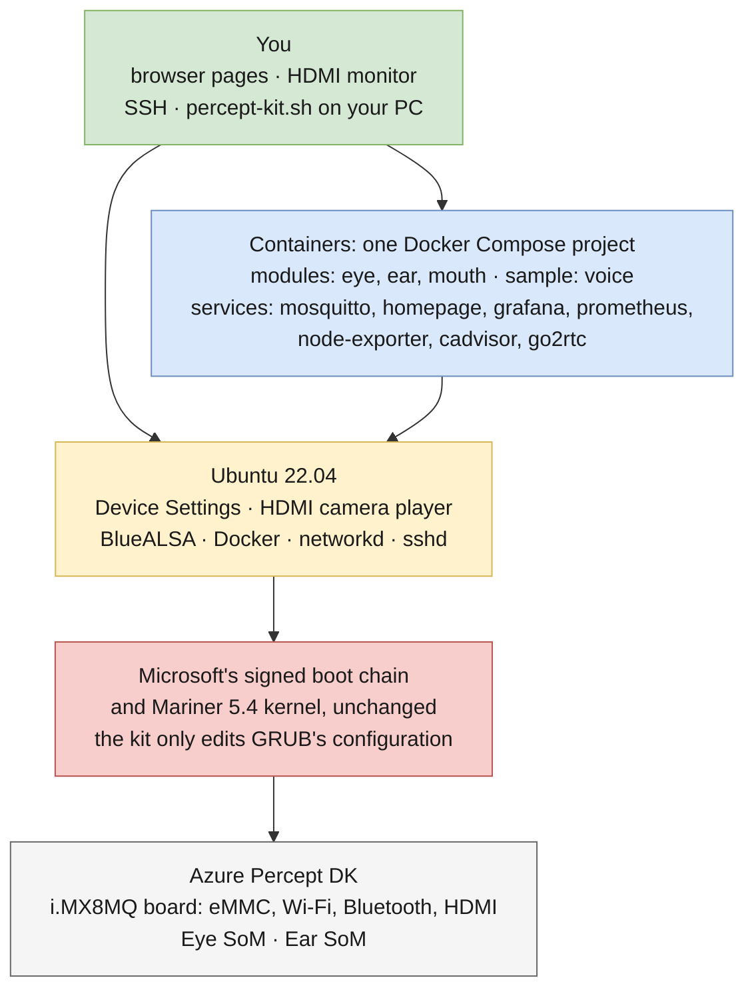
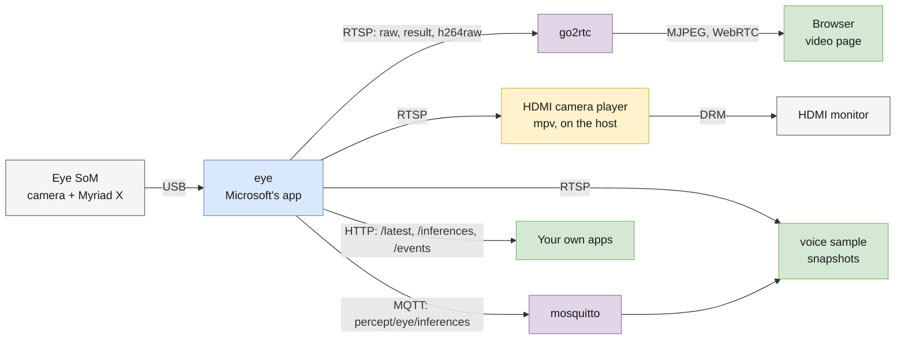
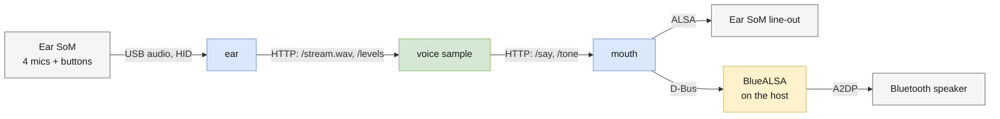
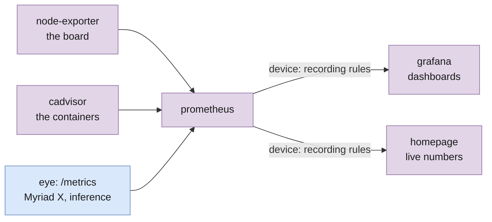
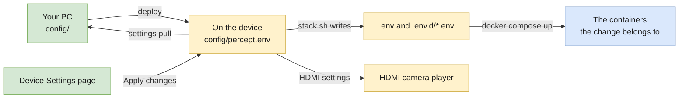
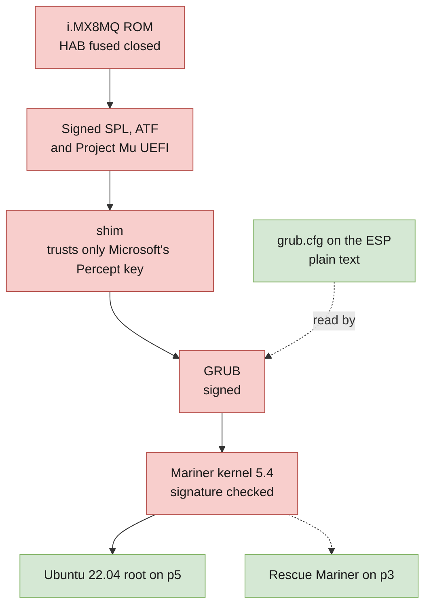
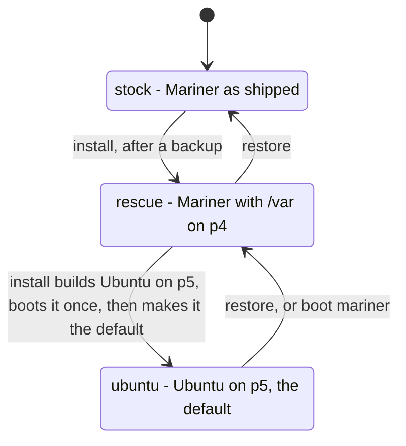
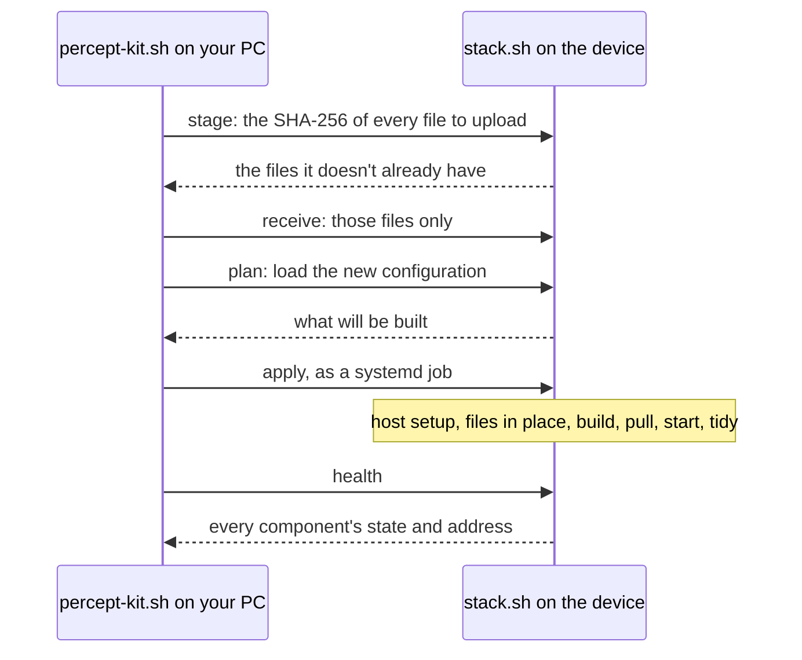

# Architecture: how percept-kit fits together

This document shows how the pieces work together: the layers, how data flows between the parts,
how settings reach them, how the device boots, and how the kit installs, updates and restores it.
- What the project is for: [README.md](README.md).
- How each part of the board was made to work on Ubuntu, and where every piece comes from:
  [PROVENANCE.md](PROVENANCE.md).

## Contents

1. [The layers](#the-layers)
2. [Modules, samples and services](#modules-samples-and-services)
3. [How data flows](#how-data-flows)
4. [Settings: one file, two ways to change it](#settings-one-file-two-ways-to-change-it)
5. [The containers](#the-containers)
6. [Boot](#boot)
7. [Install, deploy and restore](#install-deploy-and-restore)
8. [Repository layout](#repository-layout)

## The layers



- **Hardware.** The Percept DK's carrier board and its two USB accessories, the Eye SoM and the
  Ear SoM. [ASSESSMENT.md](ASSESSMENT.md) lists it all.
- **Boot.** Microsoft's signed firmware, shim, GRUB and kernel, untouched. The kit edits only
  GRUB's plain-text configuration, so that the same kernel boots Ubuntu ([Boot](#boot)).
- **Ubuntu 22.04.** The operating system, with the kernel's modules and firmware copied from
  Microsoft's Mariner OS. A few services run on the host rather than in Docker, because they
  control the host itself: Device Settings, the HDMI camera player, and BlueALSA (Bluetooth audio).
- **Containers.** Everything else is one Docker Compose project, defined in
  [compose.yaml](compose.yaml).
- **You.** Web pages in a browser, the HDMI monitor, SSH, and `percept-kit.sh` on your PC.

## Modules, samples and services

The repository's top folders follow the role each part plays, not where its code came from.

| Kind | Folder | What it is |
|---|---|---|
| **Module** | `modules/` | One container per piece of hardware. It is the only thing that talks to its hardware, and it makes the hardware available to everything else over the network |
| **Sample** | `samples/` | An example application. It owns no hardware and uses only what the modules offer. Nothing depends on it, so it can be changed, replaced or switched off |
| **Service** | `services/` | The parts that run the device rather than use its hardware: the MQTT broker and the dashboard (the projects' own images, with the kit's configuration), and Device Settings |

| | Hardware it owns | What it offers | Used by |
|---|---|---|---|
| [Eye](eye.md), `modules/eye` | The camera and the Myriad X | Video over RTSP; each inference result over HTTP and MQTT; metrics | The video page, the HDMI camera, Grafana, the voice sample |
| [Ear](ear.md), `modules/ear` | The 4 microphones and the 2 buttons | Live audio, mic levels, the buttons' state | The voice sample |
| [Mouth](mouth.md), `modules/mouth` | The line-out and Bluetooth speakers | Text-to-speech, playback, speaker pairing | The voice sample, Device Settings, the home page |
| [Voice sample](samples/voice/README.md), `samples/voice` | None | Nothing the others use | Nobody |

Remove the voice sample and everything else still works. Remove a module and the device loses
a capability.

- **The Eye is a module, though its code is Microsoft's.** On the stock Percept, Microsoft's Eye
  module (`azureeyemodule`) was already the one container that drove the Eye SoM. percept-kit
  keeps that code and that role, and adds local outputs in place of Azure IoT Hub, which make it
  a service for everything else. Its demo-like part, the default object-detection model, is a
  setting (`EYE_MODEL`), not code.
- **The voice sample isn't part of the Ear.** Microsoft's Ear module was a cloud voice assistant:
  microphone handling and application logic in one container, needing Azure. percept-kit splits
  it in two. The hardware side became the ear and mouth modules; the application side (wake word,
  commands, replies) became the voice sample, which runs offline.

The host services, which run outside Docker:

| Host service | What it does | Details |
|---|---|---|
| `percept-settings` | Device Settings: the page and its API | [customize.md](customize.md#change-settings-on-the-device) |
| `percept-camera` | In camera mode, plays the Eye's video on the HDMI monitor with mpv | [customize.md](customize.md#show-the-camera-on-the-hdmi-monitor) |
| `bluetooth`, `bluez-alsa`, `percept-bt-connect` | Bluetooth audio for the mouth; reconnects trusted speakers at boot | [mouth.md](mouth.md#how-it-works) |
| `percept-ear-audio` | Reloads the USB audio driver when the Ear SoM appears late in boot | [PROVENANCE.md](PROVENANCE.md#microphones-and-buttons-the-ear-som) |

## How data flows

All containers share the Docker network `percept` and reach each other by name (`eye`,
`mosquitto`…). The MQTT broker publishes no port, so only the containers reach it.

### Vision and video



- The Eye runs Microsoft's inference app on the Myriad X. Every result goes out over MQTT and
  HTTP, and is drawn into the `result` video ([eye.md](eye.md)).
- Browsers can't play RTSP, so go2rtc relays the streams to them without transcoding
  ([dashboard.md](dashboard.md#video)).
- In camera mode, the camera player shows a stream full screen on the HDMI monitor, with no
  desktop ([customize.md](customize.md#show-the-camera-on-the-hdmi-monitor)).

### Audio



- The Ear streams the microphones. The voice sample listens, decides what to answer, and asks
  the mouth to say it ([samples/voice/README.md](samples/voice/README.md#how-it-works)).
- The mouth plays on a connected Bluetooth speaker, otherwise on the Ear's line-out. Its
  requests return only when the sound has finished, so the sample can stop listening while the
  device talks ([mouth.md](mouth.md#how-it-works)).

### Metrics



Prometheus pulls the metrics and stores them. Grafana's headline numbers and the home page's
come from the same recording rules, so they can't disagree
([dashboard.md](dashboard.md#how-it-works)).

## Settings: one file, two ways to change it



- **One file.** Every setting lives in `config/percept.env`, and each is documented once, in
  [config.example/percept.env](config.example/percept.env). Files that settings refer to (models,
  label files, certificates) go in `config/files/`, which the containers see read-only at
  `/config/files`. Other changes to the services go in `config/compose.override.yaml`, which
  Compose merges over `compose.yaml`.
- **From your PC**: edit `config/`, then `./percept-kit.sh deploy` copies it to the device and
  applies everything ([Deploy](#deploy)).
- **On the device**: the Device Settings page changes the device's copy, then `stack.sh configure`
  applies just that change. It recreates only the containers the changed settings belong to, and
  builds nothing ([customize.md](customize.md#change-settings-on-the-device)).
- **What the containers read.** From the file, `stack.sh` writes `~/percept-kit/.env`: the
  device's facts (the address your PC uses, the names Homepage must accept, the `audio` and
  `input` group IDs), `COMPOSE_PROFILES`, `COMPOSE_FILE`, then the settings. So plain
  `docker compose` in `~/percept-kit` needs no flags. Each module also gets only its own settings
  (`EYE_*`, `EAR_*`, `MOUTH_*`, `VOICE_*`) in an env file in `.env.d/`, so a change recreates only
  its module. `compose.yaml` maps the shared `MQTT_*` settings onto the Eye's and the voice
  sample's own.
- **Neither overwrites the other.** After a change on the page, `deploy` stops until
  `./percept-kit.sh settings pull` has copied the device's `config/` to your PC.

## The containers

| Service | Image | How it runs |
|---|---|---|
| `eye` | `percept/eye`, built on the device | The whole USB bus is mounted, because the Myriad X re-enumerates ([eye.md](eye.md#how-it-runs)) |
| `ear` | `percept/ear`, built on the device | `/dev/snd`; `/dev/input` read-only, for the buttons |
| `mouth` | `percept/mouth`, built on the device | `/dev/snd`, and the host's D-Bus for Bluetooth |
| `voice` | `percept/sample-voice`, built on the device | |
| `mosquitto` | Eclipse Mosquitto | Only while `MQTT_URL` is empty (Compose profile `local-mqtt`) |
| `homepage`, `grafana`, `prometheus`, `node-exporter`, `cadvisor`, `go2rtc` | The projects' own images | [dashboard.md](dashboard.md#how-it-works) |

- Image versions are pinned in `compose.yaml` and nowhere else. The images built on the device
  never leave it.
- Every container restarts by itself (`unless-stopped`) and logs to Docker's size-capped `local`
  driver.
- Container names are the service names.
- The kit creates the network and the data volumes (`mouth-cache`, `voice-data`,
  `prometheus-data`, `grafana-data`) outside the project, so `docker compose down -v` can't delete
  them.

Each component's address is in [README.md](README.md#what-you-get).

## Boot

### Secure Boot you can't turn off



Red: signed and checked; green: not checked.

- Only Microsoft-signed firmware can run, and UEFI Secure Boot trusts only Microsoft's Percept
  key. Ubuntu's own shim, signed by the Microsoft UEFI CA, isn't trusted, and UEFI setup can't be
  reached to turn Secure Boot off.
- But GRUB's configuration, `grub.cfg`, is plain text that nothing checks, and neither is the root
  filesystem.
- So the kit keeps Microsoft's shim, GRUB and **Mariner 5.4 kernel**, and changes `grub.cfg` to
  point that kernel at an Ubuntu 22.04 root. Ubuntu's userland gets normal `apt` updates; the
  kernel stays at `5.4.3-26.cm1` for good. That's why 22.04, the newest LTS that is comfortable on a
  5.4 kernel, was chosen.

How this was established, and what Ubuntu needed to run on that kernel:
[PROVENANCE.md](PROVENANCE.md#booting-ubuntu-on-a-locked-board).

### eMMC layout

The eMMC is 16 GB (`/dev/mmcblk0`), plus two 4 MB hardware boot partitions holding the signed
firmware (`mmcblk0boot0/1`). The kit reads those for the backup and **never writes them**.

| Partition | Stock | After `install` |
|---|---|---|
| p1 ESP (11 MB) | `EFI/BOOT/bootaa64.efi` (shim), `grubaa64.efi`, `boot/grub2/grub.cfg`, `pe100.dtb` | Same binaries. The kit's `grub.cfg` (original kept as `grub.cfg.orig`), `boot/grub2/grubenv`, `pe100-hdmi.dtb` |
| p2 ESP B (11 MB) | Unused A/B update slot | Unchanged |
| p3 (2 GB) | Mariner root (`/boot/vmlinuz` lives here) | Mariner root, switched to **rescue** mode |
| p4 (2 GB) | Mariner root B (unused update slot) | Mariner's `/var`, ext4 label `pk-mariner-var` |
| p5 (10.5 GB) | Mariner `/var`: IoT Edge, Docker images, logs | **Ubuntu 22.04 root**, ext4 label `ubuntu-root` |

Ubuntu and Mariner boot the same kernel file, `/boot/vmlinuz` on p3. Ubuntu carries a copy of the
matching modules and firmware in its own root.

### Boot menu and one-shot boots

`scripts/install-grub-cfg.sh` renders `scripts/grub.cfg.template` onto the ESP:

| Entry | Name | Root | Device tree |
|---|---|---|---|
| 0 | Mariner | `/dev/mmcblk0p3` (stock command line) | `pe100.dtb` (stock) |
| 1 | Ubuntu | `PARTUUID=<p5>` | `pe100-hdmi.dtb` |
| 2 | Ubuntu (original device tree, no HDMI) | `PARTUUID=<p5>` | `pe100.dtb` |

`pe100-hdmi.dtb` is Microsoft's `pe100.dtb` with the HDMI display nodes, which Microsoft had
removed, put back. It's built on each device from that device's own `pe100.dtb`
([PROVENANCE.md](PROVENANCE.md#hdmi-the-console-and-the-camera)). Entry 2 is there in case that
tree ever misbehaves.

**One-shot boots** are how every risky boot is tried. The kit writes `next_entry=N` into
`grubenv`. On the next boot GRUB reads it, clears it, and boots entry N **only if saving the
cleared value succeeded**. If that boot hangs, the watchdog or a power cycle lands on the
*default* entry, never on N again. While `install` builds Ubuntu, the default stays Mariner, and
Ubuntu is tried once; when that trial boot comes up, Ubuntu becomes the default.

The GRUB menu itself appears only on the internal serial console. On HDMI, Linux shows from the
kernel onwards.

### Rescue Mariner

p5 is the only partition big enough for Ubuntu, and it holds Mariner's `/var`. Mariner can't
simply be deleted: it owns the signed kernel, and it's the only OS that can rewrite the eMMC if
Ubuntu breaks. So `install` first turns Mariner into a **rescue system**: its `/var` moves to p4
(without the container images, about 60 MB), IoT Edge, Docker and the update agents are kept from
starting, and p5 is free. Rescue Mariner keeps your user, SSH key and Wi-Fi settings.
`restore` undoes it exactly ([PROVENANCE.md](PROVENANCE.md#making-room-rescue-mariner)).

## Install, deploy and restore

### Device states



`scripts/kit/state.sh` inspects the device read-only and reports its state. Every command checks it
before acting.

| State | Meaning | Valid commands |
|---|---|---|
| `stock` | Mariner with `/var` on p5, ESP as shipped | `assess`, `backup`, `install`, `restore` (finishes a restore by rewriting p4) |
| `rescue` | Mariner with `/var` on p4 (`/etc/percept-kit/rescue` present) | `install` (carries on, or rebuilds p5), `commit`, `boot`, `restore` |
| `ubuntu` | Ubuntu running from p5 | `deploy` and the other stack commands, `settings`, `install` (finishes the remaining steps), `commit`, `boot`, `restore` |
| `usb-ubuntu` | Ubuntu running from a USB disk (development) | `deploy` and the other stack commands, `assess` |

### The PC kit

`percept-kit.sh` runs on your PC (Git Bash on Windows, or bash on Linux/macOS) and drives the device
over SSH.

- **Connection.** `.percept-kit.conf` holds `HOST`, `DEVUSER` and `KEY` (default
  `~/.ssh/id_ed25519_percept`). `connect` creates the key if needed, installs it with one password
  login, and adds a sudoers rule (checked with `visudo`) for passwordless sudo.
- **Scripts.** Before each command that changes the device, the kit uploads `scripts/` to
  `~/percept-kit/scripts`, without Windows line endings. Read-only helpers (`state.sh`,
  `assess.sh`) are piped over SSH instead.
- **Long jobs** (rescue preparation, the Ubuntu build, GRUB install, `deploy`, `rebuild`) run on the
  device as transient systemd units, logging to `/var/tmp/pk-<name>.log`. The kit tails the log
  every 5 s, so a dropped Wi-Fi or SSH connection doesn't stop the job: the kit reconnects and
  carries on.
- **Reboots** are scheduled 2 s ahead. The kit then polls every 15 s, for up to 15 minutes, for a
  new `boot_id`.
- **Mariner's SSH rate limit** drops a PC that opens 6 SSH connections in a minute. Each time the
  kit reads the state, it also adds a runtime-only exemption for the PC's address
  ([PROVENANCE.md](PROVENANCE.md#driving-the-device-from-a-pc)).

### Deploy



`deploy` runs `scripts/stack.sh` on the device, as root. It uploads `compose.yaml`, `modules/`,
`samples/`, `services/`, `config.example/` and your `config/`, then:
1. **Upload.** The device keeps the files it already has, as hard links, and asks only for the
   others, so an unchanged 65 MB model isn't sent again. Windows line endings are removed from the
   text files received. If settings were changed on the device since the last deploy and your
   PC's `config/` doesn't match them, it stops here until you run `settings pull`.
2. **Check.** It writes the new `.env` and loads the configuration. If Compose rejects it, `deploy`
   stops there and nothing has changed.
3. **Host setup.** It installs what's missing (Compose, Buildx, rsync, mpv), applies the journal cap
   and the Wi-Fi driver's log level, and sets up BlueALSA with `modules/mouth/bt.sh`.
4. **Files.** `rsync --inplace` rewrites each changed file where it is, so a container that mounts a
   folder sees the new content.
5. **Build.** Each image built on the device carries a label with the hash of its source folder
   (documentation aside). Only images whose folder changed are rebuilt, one at a time, each after a
   check that there's room. The Eye's build needs its base image in Docker; the kit loads it from
   your backup, or pulls it, beforehand.
6. **Pull** missing images, after a check that there's room to unpack them.
7. **Start.** Services switched off by a profile are removed. `docker compose up -d` creates or
   recreates what changed, and services whose mounted files changed are restarted. Device Settings
   and the HDMI camera player are installed and (re)started.
8. **Tidy.** The build cache, dangling images, anonymous volumes and replaced image versions are
   deleted.
9. **Check.** `stack.sh health` checks every component over HTTP (MQTT for the broker), retrying
   for up to 5 minutes, and prints each one's address. It warns, rather than fails, when an SoM or
   the Bluetooth adapter is missing.

`install` runs `deploy` once Ubuntu is the default, then reboots and checks again, so the device is
known to come back by itself. `status`, `logs`, `restart`, `stop`, `start`, `rebuild` and
`compose` run `docker compose` on the device
([customize.md](customize.md#use-docker-compose-directly)).

### Backups

`backup` (from stock Mariner) writes `backups/<yyyymmdd-hhmmss>-<last 8 of eMMC CID>/`:

| File | Contents |
|---|---|
| `kit-backup.conf` | CID, state, model, OS, hostname, timestamp. `install`/`restore` only use a backup whose CID matches the device |
| `assess.txt` | The `assess` report at backup time |
| `gpt-primary.bin`, `gpt-backup.bin` | Raw GPT headers and partition tables (first 34 / last 33 sectors) |
| `custom-configs.tar.gz` | Mariner's `/var/custom-configs`: users, SSH, Wi-Fi, sudoers, IoT Edge configuration |
| `boot0`, `boot1`, `p1`...`p5` `.img.zst` | Every partition, raw `dd` image compressed with zstd on the device |
| `p5-consistent.img.zst` | Added by `install`: p5 imaged from rescue Mariner while unmounted |
| `eye-base.tar.zst` | `docker save` of the Eye's build base from the device's own IoT Edge cache, about 420 MB. An Eye build loads it when Docker doesn't have the image, before trying Microsoft's registry. `eye-base save` adds it to an existing backup |
| `SHA256SUMS` | Hashes of the files above, computed on the PC after transfer and matched against the device's |
| `RAW-SHA256SUMS` | Hashes of the uncompressed partitions, used to verify restores |

During the backup, IoT Edge and Docker are stopped so p5 is as quiet as a live copy can be. p3 and p5
are still mounted, so their images are only crash-consistent. That's why `install` also saves
`p5-consistent`, and why `restore` never writes p3 from an image. The folder is named `.partial`
until every file is written and verified. A backup is about 4 GB (7 GB once `install` has added
`p5-consistent`) and takes about 20 minutes over Wi-Fi.

### Restore

`restore` walks the device back to stock:
1. **From Ubuntu**: a one-shot boot into rescue Mariner (entry 0).
2. **From rescue**: write p5 (`p5-consistent` if present, else `p5`) and p1 (the stock ESP, which
   removes the kit's menu); undo the rescue changes on p3 (`restore-stock-p3.sh`); reboot into stock
   Mariner.
3. **From stock with p4 still labelled `pk-mariner-var`**: write p4 back.

`scripts/kit/write.sh` streams each image, then re-reads the partition and compares its SHA-256 with
`RAW-SHA256SUMS`. It refuses to write a mounted partition, p5 outside rescue, p4 unless `/var` is on
p5, or anything other than p1–p5.

## Repository layout

```
percept-kit.sh                 the PC side: every command
.percept-kit.conf              device address, user and key (written by connect; not committed)
compose.yaml                   the device's containers, how they run, and every image version
config.example/                percept.env (every setting, documented) and files/; copy it to config/
config/                        yours: percept.env, files/, compose.override.yaml (not committed); see customize.md
scripts/
  build-ubuntu-rootfs.sh       the Ubuntu 22.04 root on p5 (or a USB disk)
  install-grub-cfg.sh          ESP grub.cfg + grubenv + HDMI device tree; default and one-shot entries
  grub.cfg.template            the three-entry menu
  build-hdmi-dtb.sh            pe100.dtb + hdmi-dcss-nodes.dtsi -> pe100-hdmi.dtb (on the device)
  hdmi-dcss-nodes.dtsi         the display nodes added to Microsoft's device tree
  rescue-prep.sh               stock -> rescue Mariner
  restore-stock-p3.sh          rescue -> stock Mariner (p3 side)
  stack.sh                     deploy, configure, rebuild, health and status on the device
  host/                        systemd units and udev rules for Ubuntu: the Ear audio fix, Device Settings, the HDMI camera
  kit/state.sh                 the device state report
  kit/assess.sh                hardware and software report
  kit/dump.sh, kit/write.sh    partition images out and in, with hashes
  kit/ssh-exempt.sh            runtime SSH rate-limit exemption
  kit/config_guard.py          stops a deploy from overwriting settings changed on the device
modules/eye/                   the Eye's image: Dockerfile, collect-rootfs.sh, entrypoint.sh, app/ (Microsoft's app); eye.md
  eye/app/output/              inference outputs (stdout, HTTP, MQTT) and metrics, added to Microsoft's app
modules/ear/                   the Ear's image (ear.py); ear.md
modules/mouth/                 the audio output image (mouth.py) + bt.sh (host Bluetooth setup, pairing); mouth.md
samples/voice/                 the voice sample: voice.py, Dockerfile, requirements.txt (pinned)
services/mqtt/                 mosquitto.conf, the device's MQTT broker
services/dashboard/            prometheus/, grafana/, homepage/ and go2rtc/ configuration
services/settings/             Device Settings (server.py, configuration.py, the page) and the HDMI camera player
tests/                         hardware-free tests of Device Settings: python -B -m unittest discover -s tests
docs/images/                   the screenshots in these documents
dtb/                           NXP's reference device-tree sources; locally also pe100.dtb and files derived from it (not committed)
backups/, reports/             created by the kit (not committed)
```
