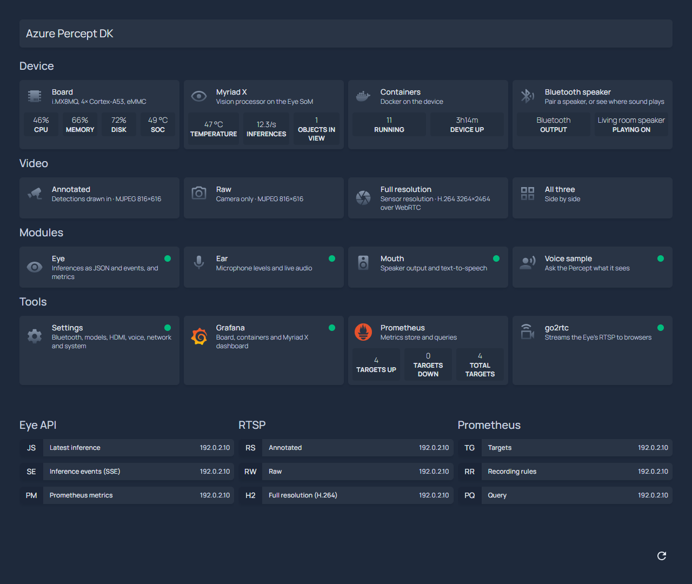
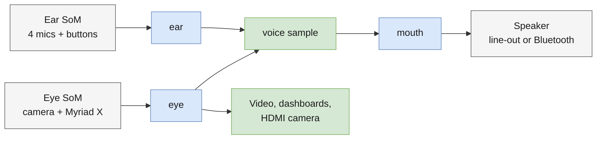

# percept-kit: a second life for the Azure Percept DK

The **Azure Percept DK** (APDK-101) was Microsoft's edge AI development kit: a carrier board with
an NXP i.MX8MQ processor, a camera module with an Intel Myriad X AI accelerator (the **Eye**), and a
four-microphone array (the **Ear**). Its software was built for Azure: Microsoft's CBL-Mariner OS,
Azure IoT Edge modules, IoT Hub, Azure Percept Studio and Azure Speech. Microsoft retired Azure
Percept in March 2023. The OS no longer gets updates, and the cloud features stopped working.

**percept-kit gives the hardware a second life.** One command turns a Percept DK into a standalone
Ubuntu 22.04 device:
- **Azure is optional.** Everything runs on the device, with no account or cloud service. When you
  want the results in Azure, the Eye sends them to Azure IoT Hub
  ([customize.md](customize.md#send-the-results-to-azure-iot-hub)).
- **The Percept's own features keep working**, starting with Microsoft's own vision AI app on the
  Myriad X.
- **New ones make it easy to use**: a home page, dashboards, a settings page, the camera in a
  browser or on a monitor, Bluetooth speakers, and a voice sample that says what the camera sees.
- **Nothing is lost.** Microsoft's OS stays on the device as a rescue system, and the stock image
  can be restored bit for bit.



## The Percept's features, then and now

| Feature | On the stock Percept DK | With percept-kit |
|---|---|---|
| **Vision AI** (Eye SoM: camera and Myriad X) | Microsoft's Eye module, `azureeyemodule`, under IoT Edge. Every inference went to Azure IoT Hub, and models came from Azure Percept Studio | The same Microsoft app, built on the device from Microsoft's open-source repository. Inferences go out over HTTP and MQTT, and MQTT can still deliver them to Azure IoT Hub ([customize.md](customize.md#send-the-results-to-azure-iot-hub)). Models load from a file or a URL, and the kinds the app supports still work, including the Azure Percept model zoo and Custom Vision exports ([eye.md](eye.md#models)) |
| **Camera video** | RTSP streams from the Eye module | The same streams, also in a browser, and full screen on an HDMI monitor |
| **Microphones and buttons** (Ear SoM) | Microsoft's speech module, an Azure Speech voice assistant. Its keyword model downloads from Azure, so it no longer works | Live audio, mic levels and the buttons' state over HTTP, and offline voice commands in the voice sample |
| **Speaker** | The Ear's line-out | The line-out or a Bluetooth speaker, with an offline neural voice |
| **HDMI** | Nothing: Microsoft's device tree leaves the display out | The Linux console, or the camera full screen |
| **Operating system** | CBL-Mariner 1.0, end of life | Ubuntu 22.04 with `apt` updates, on Microsoft's own signed kernel |
| **Wi-Fi and login** | Set up by the Percept's setup experience | Carried over: the same network, user, password and SSH keys |

What percept-kit adds:
- **A home page** that links every page on the device, with live numbers.
- **Dashboards** in Grafana: the board, the containers, the Myriad X and inference.
- **Device Settings**: every setting on one page, from the model and the HDMI monitor to
  Bluetooth speakers, the network and the host name.
- **A voice sample**: say "percept, what do you see?" and it answers out loud.
- **Backup and restore**: a full image of the eMMC is taken before anything changes, and `restore`
  brings the stock OS back.

## Quick start

In Git Bash on Windows, or bash on Linux or macOS:

```bash
git clone https://github.com/howardginsburg/AzurePerceptDKUbuntu.git && cd AzurePerceptDKUbuntu
./percept-kit.sh connect <device-ip> <user>   # SSH key and passwordless sudo
./percept-kit.sh install                      # backup, Ubuntu, every component: 1-2.5 hours
```

Then pair a Bluetooth speaker from the home page. [setup.md](setup.md) walks through it.

## What you get

| Component | Address | What it is | Details |
|---|---|---|---|
| Home page | `http://<ip>/` | Links to everything below, with live numbers | [dashboard.md](dashboard.md#home-page) |
| Device Settings | `http://<ip>:8002/` | Every setting on one page: the HDMI monitor (console or camera), the model, Bluetooth, voice, MQTT, metrics history, network, host name, reboot | [customize.md](customize.md#change-settings-on-the-device) |
| Grafana | `http://<ip>:3000/` | Dashboards of the board, the containers, the Myriad X and inference. No sign-in | [dashboard.md](dashboard.md#grafana) |
| Video | `http://<ip>:1984/` | The Eye's three video streams in a browser | [dashboard.md](dashboard.md#video) |
| Eye | `rtsp://<ip>:8554/result`, `http://<ip>:8555/` | Camera and Myriad X inference: video, and detections as JSON over HTTP and MQTT | [eye.md](eye.md) |
| Ear | `http://<ip>:8000/` | The four microphones: levels, live audio, and the Mute and PTT/PTS buttons | [ear.md](ear.md) |
| Mouth | `http://<ip>:8001/` | Sound on a Bluetooth speaker or the line-out, offline neural text-to-speech, and Bluetooth pairing (`#bt`) | [mouth.md](mouth.md) |
| Voice sample | `http://<ip>:8080/` | Spoken commands answered from what the Eye sees | [samples/voice/README.md](samples/voice/README.md) |
| MQTT broker | `mosquitto:1883`, for the containers only | Carries the Eye's inferences to the voice sample. One setting swaps in your own broker | [customize.md](customize.md#use-your-own-mqtt-broker) |
| Prometheus | `http://<ip>:9090/` | The metrics store | [dashboard.md](dashboard.md#metrics) |
| node_exporter, cAdvisor | `http://<ip>:9100/metrics`, internal | The board's and the containers' metrics | [dashboard.md](dashboard.md#metrics) |

## How it fits together



Grey: hardware. Blue: modules. Green: what uses them.

- **Modules** (`modules/`): one per piece of hardware: the Eye, the Ear, and the mouth (the
  speaker). Each is the only thing that talks to its hardware, and it offers that hardware to
  everything else.
- **Samples** (`samples/`): example applications built only on what the modules offer. The voice
  sample is one. Nothing depends on it, so you can change it, replace it or switch it off.
- **Services** (`services/`): the MQTT broker, the dashboard and Device Settings.

[ARCHITECTURE.md](ARCHITECTURE.md) shows the layers, how data flows, how settings reach each part,
and how the device boots, installs, updates and restores.

## Limits

- The kernel is Microsoft's 5.4 and never gets security updates. Treat the device as a lab or edge
  appliance on a trusted network, not an internet-facing server: its web pages and APIs have no
  sign-in ([dashboard.md](dashboard.md#security)).
- No Ubuntu kernels, initramfs, snaps or software that needs AppArmor.
- Microsoft's USB-C reflash tool is retired, so never modify `bootaa64.efi`, `grubaa64.efi` or the
  eMMC's hardware boot partitions. The kit never does ([ARCHITECTURE.md](ARCHITECTURE.md#emmc-layout)).
- Bluetooth is Classic only, which is all speakers need: the kernel crashes in its Bluetooth LE
  code ([mouth.md](mouth.md#how-it-works)).
- The HDMI camera stops at 1280×720
  ([customize.md](customize.md#show-the-camera-on-the-hdmi-monitor)).
- Ubuntu can be given a different IP address from the one Mariner had
  ([setup.md](setup.md#if-the-ip-address-changes)).
- Now and then the Ear and Bluetooth are missing after a reboot, until the next one
  ([setup.md](setup.md#the-ear-or-bluetooth-is-missing-after-a-reboot)).

## Documents

| Document | Contents |
|---|---|
| [setup.md](setup.md) | From a stock device to Ubuntu with everything running; day-to-day commands; and back |
| [customize.md](customize.md) | Changing things, on the Device Settings page or from your PC: the model, the MQTT broker, Azure IoT Hub, the HDMI monitor, the voice sample, the speaker, the dashboards, your own containers, disk space |
| [ARCHITECTURE.md](ARCHITECTURE.md) | How it fits together, with diagrams: the layers, data flows, settings, boot, install, deploy and restore, and the repository |
| [eye.md](eye.md) | The Eye: camera and Myriad X inference, its outputs, models and metrics |
| [ear.md](ear.md) | The Ear: the 4-mic array and its buttons |
| [mouth.md](mouth.md) | The mouth: line-out and Bluetooth speaker, offline neural text-to-speech |
| [dashboard.md](dashboard.md) | The home page, Grafana, Prometheus and the video page |
| [samples/voice/README.md](samples/voice/README.md) | The voice sample: spoken commands answered from what the Eye sees |
| [PROVENANCE.md](PROVENANCE.md) | How each part of the board was kept working on Ubuntu, where every component comes from, and the licences |
| [ASSESSMENT.md](ASSESSMENT.md) | The stock device: hardware, software, eMMC and boot chain |
