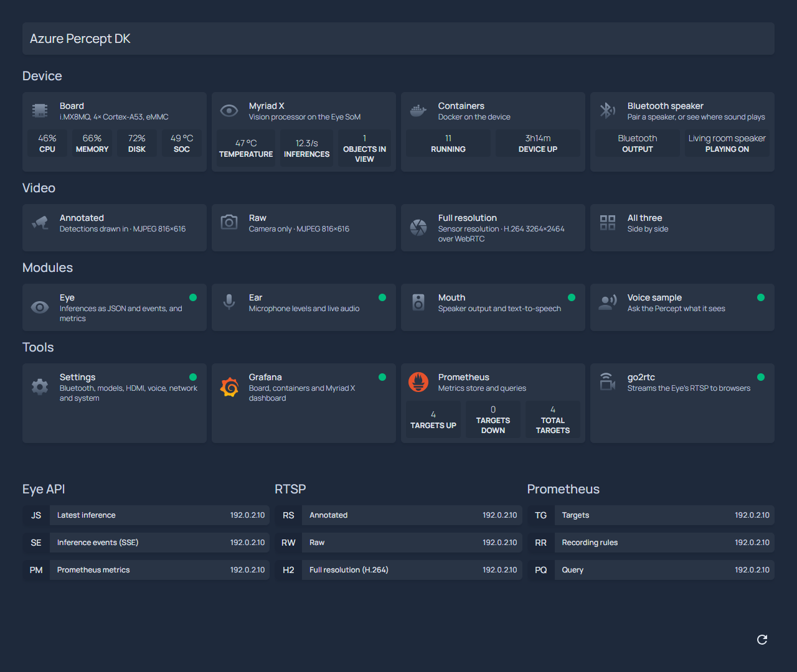
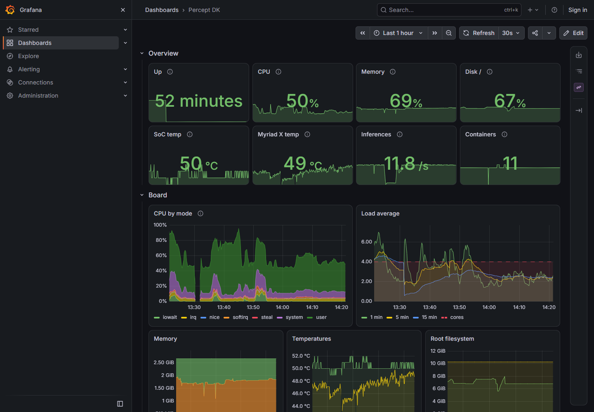
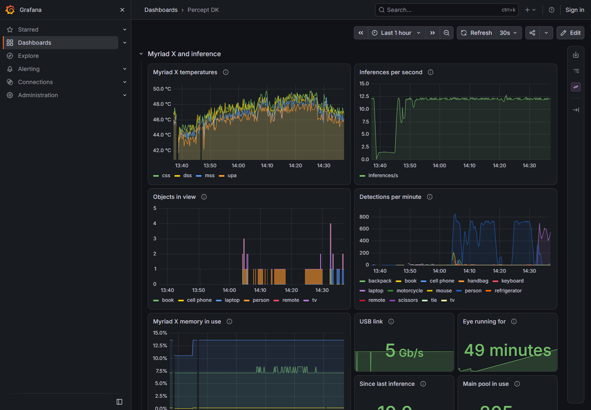
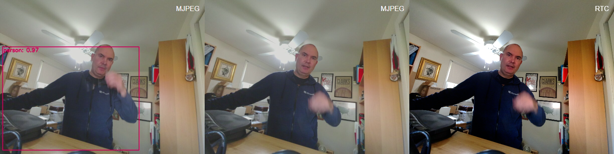

# Dashboard: home page, Grafana, metrics and video

The device's web front end:

| Page | Address | What it shows |
|---|---|---|
| Home | `http://<ip>/` | [Homepage](https://gethomepage.dev): every web page on the device in one place, with live numbers and up/down dots |
| Grafana | `http://<ip>:3000/` | The *Percept DK* dashboard: the board, the containers, the Myriad X and inference |
| Video | `http://<ip>:1984/` | [go2rtc](https://github.com/AlexxIT/go2rtc): the Eye's three RTSP streams in a browser |
| Prometheus | `http://<ip>:9090/` | The metrics store, for your own queries |

It's six containers, all from their projects' published images; nothing is built. Prometheus
collects the metrics: every 15 s it pulls them from node_exporter (the board), cAdvisor (the
containers) and the Eye itself (the Myriad X and inference). Only the process that owns the Myriad X
can talk to it, so those metrics come from the Eye's own [`/metrics`](eye.md#prometheus-metrics-and-myriad-x-telemetry).
`install` starts them with everything else; [customize.md](customize.md#change-the-dashboard)
covers changing them.

## Home page



The page at `http://<ip>/` has four groups of cards, then bookmarks:

| Group | Cards |
|---|---|
| Device | **Board**: CPU, memory, disk and SoC temperature. **Myriad X**: temperature, inferences per second, objects in view. **Containers**: how many run, and how long the device has been up. These three open Grafana. **Bluetooth speaker**: where sound plays now; it opens the mouth page's Bluetooth section to pair a speaker ([setup.md](setup.md#3-pair-a-bluetooth-speaker)) |
| Video | The Eye's annotated, raw and full-resolution streams, and all three side by side ([Video](#video)) |
| Modules | The Eye's API, the [Ear](ear.md), the [mouth](mouth.md) and the [voice sample](samples/voice/README.md), each with a dot that turns red when it doesn't answer |
| Tools | **Settings**: opens Device Settings ([customize.md](customize.md#change-settings-on-the-device)). Grafana, Prometheus (with its scrape targets up and down) and go2rtc |
| Bookmarks | The Eye's `/latest`, `/events` and `/metrics`; the three `rtsp://` URLs (they open in VLC if it's registered for `rtsp://`); Prometheus' targets, recording rules and query pages |

The numbers come from Prometheus, and the speaker from the mouth's `/status`. Homepage fetches them
itself, every 15 s, by container name on the Docker network `percept`, and checks each module the
same way for its dot. Device Settings runs on the host, outside Docker, so its dot is checked at the
device's address.

## Grafana

Grafana opens on the *Percept DK* dashboard, with nobody signed in, and there's no sign-in to do.
Every visitor is an organisation **Admin**, so you can edit panels, build dashboards, use Explore
and add data sources straight away. Grafana still shows a **Sign in** link at the top right, as it
does to anyone who isn't signed in; with its login switched off, it leads to an empty page. You
don't need it.



| Row | Panels |
|---|---|
| Overview | Uptime, CPU, memory, disk, SoC and Myriad X temperatures, inferences per second, containers running |
| Board | CPU by mode, load average, memory, temperatures, root filesystem, eMMC I/O, network |
| Containers | CPU, memory and network per container, and a table of the containers with their image, uptime, CPU and memory |
| Myriad X and inference | The Myriad X's four temperatures, inferences per second, objects in view and detections per minute by label, Myriad X memory, USB link, how long the Eye has run, and how old its latest result was at the last scrape |



The dashboard is provisioned from `services/dashboard/grafana/dashboards/percept-dk.json`,
read-only: save your changes as a copy (*Save as*). To change the kit's own dashboard, edit the
JSON file, or export your copy over it, and deploy; Grafana re-reads the file within a minute.

## Metrics

| Source | Job | What |
|---|---|---|
| node_exporter | `board` | CPU, load, memory, filesystems, eMMC I/O, network, the SoC's thermal zone, uptime |
| cAdvisor | `containers` | CPU, memory, network, block I/O and out-of-memory kills per container |
| The Eye's `/metrics` | `eye` | Inferences and detections by label; the Myriad X's temperatures, memory and USB link. See [eye.md](eye.md#prometheus-metrics-and-myriad-x-telemetry) |
| Prometheus | `prometheus` | Prometheus' own health |

The headline numbers are Prometheus recording rules, in `services/dashboard/prometheus/rules.yml`: the
`device:` series (`device:cpu_usage:ratio`, `device:soc_temperature:celsius`,
`device:myriadx_temperature:max_celsius`, `device:eye_inferences:rate1m` and so on). Grafana's
Overview row and the home page both show these series, so the two pages always agree.

Prometheus keeps 30 days of data, or 1 GB, whichever comes first, in the Docker volume
`prometheus-data` ([customize.md](customize.md#change-the-dashboard) changes both). It stores about
2,800 series, 185 samples a second.

## Video

| Stream | From the Eye | Format | The browser plays it with |
|---|---|---|---|
| `result` | `rtsp://eye:8554/resultTCP` | MJPEG 816×616, detections drawn in | MJPEG over a WebSocket |
| `raw` | `rtsp://eye:8554/rawTCP` | MJPEG 816×616 | MJPEG over a WebSocket |
| `h264raw` | `rtsp://eye:8554/h264raw` | H.264 3264×2464, about 25 Mbit/s | WebRTC, port 8556 |

The home page links to go2rtc's player for each stream (`http://<ip>:1984/stream.html?src=result&mode=mjpeg`,
`?src=raw&mode=mjpeg`, `?src=h264raw&mode=webrtc`) and to all three side by side. go2rtc's own page,
`http://<ip>:1984/`, lists the streams.



- Nothing is transcoded on the device. go2rtc connects to the Eye only while someone watches, and
  one connection feeds every viewer.
- Watching an MJPEG stream costs the Eye CPU, as it does with VLC: its RTSP server JPEG-encodes those
  frames only while a client is connected.
- go2rtc uses the Eye's TCP paths: its RTSP client speaks only TCP, and `/result` and `/raw` offer
  only UDP. `/resultTCP` and `/rawTCP` are the same streams over TCP.
- The full-resolution stream goes by WebRTC because go2rtc's other browser modes can't carry it.
  Its MSE player holds at most 2 MB while the browser is busy appending, which this stream fills in
  under a second, so playback stalls. go2rtc's `stream.mp4` progressive download isn't used either:
  go2rtc 1.9.15 crashes when the browser aborts it.
- WebRTC needs TCP or UDP port 8556 to reach the device, at the address the kit uses (`HOST` in
  `.percept-kit.conf`); go2rtc offers only that address and contacts no public STUN servers.
- The full-resolution stream is about 25 Mbit/s at 24 fps. A browser without hardware decoding drops
  frames, about half of them in testing.

## How it works

```
 browser ──:80────────> homepage ─┐
         ──:3000──────> grafana ──┼──> prometheus ──every 15 s──> node-exporter :9100 (host network)   the board
         ──:9090──────> prometheus┘                       ├──────> cadvisor :8080                       the containers
         ──:1984, :8556─> go2rtc ──RTSP──> eye :8554      └──────> eye :8555/metrics                    Myriad X, inference
```

The six services are in [compose.yaml](compose.yaml), which pins their image versions:

| Container | Image | Network, ports | Data | Notes |
|---|---|---|---|---|
| `homepage` | `ghcr.io/gethomepage/homepage` | `percept`; 80 → 3000 | `services/dashboard/homepage/`, read-only | Runs as uid 1000. Only answers the device's own addresses and names (`HOMEPAGE_ALLOWED_HOSTS`) |
| `grafana` | `grafana/grafana` | `percept`; 3000 | Volume `grafana-data`; provisioning and dashboard read-only | Anonymous Admin; the login, its form and basic auth are off, and no admin account is created. No update checks or plugin downloads; Go heap soft-capped at 256 MiB (`GOMEMLIMIT`) |
| `prometheus` | `prom/prometheus` | `percept`; 9090 | Volume `prometheus-data`; `services/dashboard/prometheus/` read-only | Reaches node-exporter at `host.docker.internal` |
| `node-exporter` | `prom/node-exporter` | Host network and PID namespace; 9100 | The host's `/`, read-only | Host network so that it sees the board's own interfaces |
| `cadvisor` | `ghcr.io/google/cadvisor` | `percept`; 8080 not published | cAdvisor's documented read-only mounts; privileged | Docker containers only, every 15 s, no per-container disk usage |
| `go2rtc` | `alexxit/go2rtc` | `percept`; 1984, and 8556 TCP and UDP | `services/dashboard/go2rtc/`, read-only | WebRTC offers only the kit's address for the device |

| File | Purpose |
|---|---|
| `services/dashboard/prometheus/prometheus.yml`, `rules.yml` | Scrape targets; the `device:` recording rules |
| `services/dashboard/grafana/provisioning/` | Grafana's Prometheus data source and dashboard folder |
| `services/dashboard/grafana/dashboards/percept-dk.json` | The *Percept DK* dashboard |
| `services/dashboard/homepage/` | Homepage's settings, cards (`services.yaml`), info bar (`widgets.yaml`) and bookmarks. Homepage needs all nine files |
| `services/dashboard/go2rtc/go2rtc.yaml` | The three streams, and WebRTC |

`deploy` rewrites changed files in place, so the read-only mounts see them, and restarts the
containers whose files changed. Two values come from the device's `.env`, which `deploy` writes:
- the address the kit uses for the device, for Homepage's links (`HOMEPAGE_VAR_HOST`) and go2rtc's
  WebRTC address (`PERCEPT_HOST`);
- the device's IPv4 addresses and names, which Homepage accepts (`HOMEPAGE_ALLOWED_HOSTS`).

## Resource use

Measured on the device with the Eye, Ear, mouth and voice sample running:

| Container | Memory of its own | CPU (cores, 10-minute average) | Image on disk |
|---|---|---|---|
| grafana | 180–290 MiB, plus up to about 200 MiB of file cache the kernel can reclaim | 0.06 while the dashboard was open | 1.36 GB |
| homepage | 100 MiB | 0.01 | 261 MB |
| prometheus | 60 MiB | 0.02 | 256 MB |
| cadvisor | 14 MiB | 0.01 | 63 MB |
| node-exporter | 10 MiB | 0.02 | 25 MB |
| go2rtc | 5 MiB, idle | 0 when nobody watches | 192 MB |

In all, about 0.5 GB of memory (available memory went from 1.5 GB to about 1 GB), 0.12 of the
board's 4 cores, and 2.2 GB of disk plus the stored metrics.

## Security

- Homepage, Prometheus, go2rtc and node_exporter (port 9100) have no authentication, like the
  modules. Keep the device on a trusted network.
- Device Settings (port 8002) has no sign-in either: anyone who can reach it can change settings,
  the network and the host name, and reboot or shut down the device.
- Grafana has no sign-in by design: anyone who can reach port 3000 can change dashboards, data
  sources and settings. Its own login is switched off, so a default `admin`/`admin` account can't be
  used either, from the page or the API.
- Homepage refuses requests whose `Host` isn't one of the device's addresses or names, which blocks
  DNS-rebinding pages.
- cAdvisor runs privileged, as its documentation requires, and publishes no port.
- go2rtc's configuration is read-only. Its API refuses `exec`, `echo` and `expr` sources, and sources
  with spaces, but anyone on the network can add other stream sources until it restarts.

## Troubleshooting

- **"Host validation failed" on the home page**: the device was reached under an address the kit
  didn't know. Run `./percept-kit.sh connect <ip>`, then `./percept-kit.sh deploy`.
- **The Myriad X and inference panels are empty**: the Eye isn't running a model. Check that the
  Eye SoM is plugged in, `./percept-kit.sh logs eye`, and the Eye target in `http://<ip>:9090/targets`.
- **The Grafana dashboard shows empty rows**: reload the page; a tab opened before Grafana
  restarted keeps old panel data.
- **The full-resolution video doesn't start**: port 8556 is blocked between the browser and the
  device, or the page was opened under a different address than the kit's.
- **`deploy` says there isn't enough space**: see [customize.md](customize.md#free-up-disk-space).

## Limits

- The Myriad X's temperatures and memory can only be read while the Eye is running a model.
- Grafana and the home page show values up to 15 s old (the scrape interval).
- The Eye has no microphone, so the video has no sound; the Ear's audio is on its own page.
