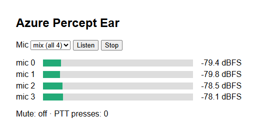

# Ear module: microphone array

The Ear SoM (Azure Percept Audio) is a USB audio device with:
- a 4-microphone linear array;
- a 3.5 mm line-out jack.

Ubuntu sees it as the ALSA sound card `USB` ("Azure Ear SoM"). The `percept/ear` container is a
small web service that lets you listen to the mics and read their levels. It needs no Azure
services. The SoM's own wake-word/voice-assistant firmware isn't used.

## What's on the board, and what Linux can use

The Ear SoM is an XMOS XUF208 audio processor plus an STM32 security controller, both running
Microsoft's signed firmware. You can't run your own code on the board: everything happens on the
DK, through what the SoM exposes over USB.

| Board part | Under Ubuntu |
|---|---|
| 4 mics | ALSA capture: 5 channels (4 mics + 1 silent), S32_LE, 16 kHz. Raw mics: the firmware does no beamforming or echo cancelling on this stream |
| 3.5 mm line-out | ALSA playback, 2 channels, 16 kHz. Used by [mouth](mouth.md) |
| **Mute** button | Works on its own: the firmware silences all four mics (they read −120 dBFS, pure zeros). ear reports it as `"mute"` |
| **PTT/PTS** button | Does nothing by itself. ear reports each press in `"ptt_presses"`; the [voice sample](samples/voice/README.md) uses it as "listen now" |
| 3 LEDs | Can't be controlled. Microsoft's speech module drove them through the Ear's "controller" serial port (`/dev/ttyACM1`, USB `045e:0673`) with an undocumented protocol. Ubuntu doesn't use that port |

Both buttons report through one HID status byte. Linux exposes it as the input device
`/dev/input/by-id/usb-Microsoft_Corporation_Azure_Ear_SoM_USB-event-if04` (`ABS_MISC`):
- bit 0: Mute is on;
- bit 1: toggles on each PTT press.

The kernel has no `hidraw`, so ear reads the input device. The mute state survives an ear
restart; unplugging or resetting the SoM clears it. If every mic reads −120 dBFS, Mute is on.
Press Mute, or check `"mute"` in `/levels`.

The Ear module is input only. Sound output (the line-out jack or a Bluetooth speaker, plus
text-to-speech) belongs to the [mouth module](mouth.md).

## The page

`http://<ip>:8000/` shows:
- live level meters for the four mics;
- a player for one mic or the 4-mic mix;
- the Mute state and a count of PTT presses.



## HTTP API

| Request | Returns |
|---|---|
| `GET /` | The web page |
| `GET /stream.wav?ch=0`…`3` | Endless live WAV, one mic, 16 kHz, 16-bit mono |
| `GET /stream.wav?ch=mix` | Endless live WAV, the average of the four mics, 16 kHz, 16-bit mono. Speech adds up across the mics while uncorrelated noise partly cancels |
| `GET /stream.wav?ch=all` | Endless live WAV, all four mics, 16 kHz, 16-bit, 4 channels |
| `GET /levels` | JSON: the RMS level of each mic in dBFS over the latest 100 ms, plus the buttons, e.g. `{"dbfs": [-52.1, -51.8, -53.0, -52.4], "mute": false, "ptt": true, "ptt_presses": 3}`. `mute`/`ptt` are `null` when the buttons can't be read. `ptt_presses` counts presses since ear started, so a slow poller misses none |

Examples:

```bash
curl -s http://<ip>:8000/levels
curl -s --max-time 10 "http://<ip>:8000/stream.wav?ch=all" -o 10s.wav   # record ~10 s
ffplay -nodisp "http://<ip>:8000/stream.wav?ch=0"                       # listen
```

Several listeners can stream at the same time. One `arecord` process feeds them all.

## How it works

- `modules/ear/Dockerfile`: Alpine 3.24 + `python3` + `alsa-utils`; runs as uid 5002. About
  60 MB.
- `modules/ear/ear.py` uses only the Python standard library:
  - Runs `arecord` on the hardware's native format: 5 channels (4 mics + 1 unused), S32_LE,
    16 kHz.
  - Converts each 100 ms chunk to 16-bit, keeping the top bits of each sample.
  - Computes levels and fans the audio out to the HTTP clients.
  - If `arecord` exits (e.g. the SoM is unplugged), it retries every 3 s.
  - A second thread reads the button device: the current state with an `EVIOCGABS` ioctl at
    start, then each change. It logs changes as `{"ts": ..., "buttons": {...}}` and retries
    every 5 s if the device is missing.
  - `arecord` lives in the container; the Ubuntu host doesn't need `alsa-utils`.
- On the host, Ubuntu has a udev rule plus `percept-ear-audio.service`. The Ear re-enumerates
  late in boot, and the sound driver can miss it; the service reloads `snd-usb-audio` if no
  "Azure Ear SoM" card appeared. See [PROVENANCE.md](PROVENANCE.md#microphones-and-buttons-the-ear-som).

## How it runs

The `ear` service in [compose.yaml](compose.yaml):
- `/dev/snd` and the host's `audio` group, for the mics;
- `/dev/input` mounted read-only, the host's `input` group, and a cgroup rule that allows reading
  input devices only (major 13), for the buttons. The whole directory is mounted, rather than one
  device, because the event number changes when the SoM re-enumerates.

`EAR_LOG_LEVELS` in `config/percept.env` adds level lines to `./percept-kit.sh logs ear`. The app
also reads these, which the kit leaves at their defaults:

| Variable | Default | Meaning |
|---|---|---|
| `EAR_DEVICE` | `hw:CARD=USB` | ALSA capture device |
| `EAR_PORT` | `8000` | HTTP port inside the container |
| `EAR_BUTTONS` | `/dev/input/by-id/usb-Microsoft_Corporation_Azure_Ear_SoM_USB-event-if04` | Input device of the buttons; `none` = off |

## Checking the hardware without the container

```bash
sudo apt install alsa-utils                             # not installed by default
arecord -l                                              # card "USB", Azure Ear SoM USB
arecord -D hw:CARD=USB -c 5 -f S32_LE -r 16000 -d 5 test.wav
speaker-test -D plughw:CARD=USB -c 2 -t sine -l 1
```

Stop the `ear` container first (`./percept-kit.sh stop ear`); only one process can capture from
the card at a time. Stop `mouth` too before running `speaker-test`, and start both again
afterwards (`./percept-kit.sh start ear mouth`).
