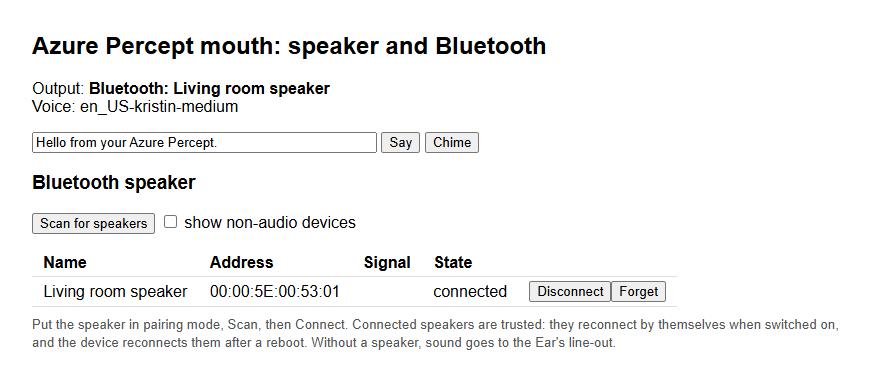

# Mouth module: speaker output, text-to-speech and Bluetooth

The `percept/mouth` container is the device's audio output. It:
- plays sound on a paired **Bluetooth speaker** when one is connected;
- otherwise plays on the Ear SoM's **3.5 mm line-out**;
- speaks text with a natural-sounding neural voice (Piper), or espeak-ng, and has a few built-in tones;
- has a web page to pair a Bluetooth speaker.

Sounds play one at a time. Each request returns when its sound has finished, so a caller (such
as the [voice sample](samples/voice/README.md)) knows when the room is quiet again. The
[Ear module](ear.md) stays input only. Everything runs on the device; no cloud speech service is
used.

## The page

`http://<ip>:8001/` shows:
- where sound plays now: the Bluetooth speaker's name, or the line-out;
- a sentence to **Say**, and a **Chime**;
- the Bluetooth section, `http://<ip>:8001/#bt`, which the home page's **Bluetooth speaker**
  card opens: **Scan for speakers**, then **Connect**, **Disconnect** or **Forget** on a speaker's
  row.



## Bluetooth speakers

[setup.md](setup.md#3-pair-a-bluetooth-speaker) walks through pairing. The kit does the same from
your PC:

```bash
./percept-kit.sh bt scan              # 15 s; lists name, MAC, signal and "audio: yes" for speakers
./percept-kit.sh bt pair AA:BB:CC:DD:EE:FF
./percept-kit.sh bt status            # paired devices + the BlueALSA playback devices
```

| Command | Effect |
|---|---|
| `bt scan [seconds]` | Discover nearby devices, then list them |
| `bt pair <MAC>` | Pair (bonded, "Just Works"), trust, and connect |
| `bt connect <MAC>` / `bt disconnect <MAC>` | Connect or disconnect a paired speaker |
| `bt forget <MAC>` | Remove the pairing |
| `bt status` | Paired devices and the BlueALSA playback devices |

After pairing:
- The speaker is used automatically while it's connected.
- Turn it off and output falls back to the line-out.
- Turn it back on and most speakers reconnect by themselves. If not, **Connect** on the page (or
  `bt connect <MAC>`) does it.
- At boot, `percept-bt-connect.service` reconnects trusted speakers for two minutes.

Speakers that need a PIN, and Bluetooth LE Audio devices, aren't supported. See
[Limits](#limits).

## HTTP API

| Request | Returns |
|---|---|
| `GET /` | The web page |
| `GET /status` | `{"sink": "bluetooth" \| "line-out", "name", "device", "playing", "bt_admin", "voice", "voices", "tts_ready"}` |
| `POST /play` | Body is a WAV file (any rate/channels, 16-bit PCM); plays it |
| `POST /say?voice=…&speed=165` | Body is UTF-8 text; speaks it. `voice` is a Piper voice from `voices`, or an espeak-ng voice (`espeak:en-us+f3`, or just `en-us`); default `MOUTH_VOICE`. `&render=1` returns the WAV instead of playing it |
| `POST /tone?kind=chime` | Built-in sounds: `chime`, `beep`, `alert` |
| `GET /bt/devices` | JSON list of the devices BlueZ knows (`mac`, `name`, `rssi`, `paired`, `trusted`, `connected`, `audio`) |
| `POST /bt/scan?seconds=12` | Discover nearby devices, then list them |
| `POST /bt/connect?mac=…` | Pair + trust + connect |
| `POST /bt/disconnect?mac=…` / `POST /bt/forget?mac=…` | Disconnect, or remove the pairing |

`/play`, `/say` and `/tone` answer `{"sink", "name", "seconds"}` after playback, for example
`{"sink": "bluetooth", "name": "Living room speaker", "seconds": 4.69}`.

```bash
curl -s http://<ip>:8001/status
curl -s -X POST --data "Hello from the Percept" http://<ip>:8001/say
curl -s -X POST "http://<ip>:8001/tone?kind=alert"
curl -s --data-binary @chime.wav http://<ip>:8001/play
curl -s -X POST --data "Saved to a file" "http://<ip>:8001/say?render=1" -o hello.wav
```

**Security**: like the Ear and Eye pages, the mouth page and API have no authentication. Anyone
on your network can play sounds and, by default, pair or remove a speaker. Set
`MOUTH_BT_ADMIN=0` to hide and refuse the Bluetooth admin actions (status and test sounds still
work); then pair with `./percept-kit.sh bt` only.

## Text-to-speech

The default voice is **Piper** `en_US-kristin-medium`, a neural voice that runs offline on the
CPU (ONNX Runtime). It sounds far more human than espeak-ng but is slower on the Percept's
Cortex-A53:

| | Measured on the device, Eye running |
|---|---|
| Voice load at start | about 13 s (in the background; the API answers at once) |
| Synthesis | about 1.2–1.6× real time: a short sentence about 2–5 s, the voice sample's help text about 8 s |
| Phrase already in the cache | about 0.01 s |
| Memory | about 290 MB (espeak-ng alone needs about 25 MB) |

Rendered Piper speech is cached in the `mouth-cache` Docker volume (`/cache`), keyed by voice, speed
and text, so repeated phrases play immediately, even after the container is recreated. The
[voice sample](samples/voice/README.md) pre-renders its fixed replies at start-up. A request
made while the voice is still loading waits for it.

espeak-ng stays available: `?voice=espeak:en-us` (or any espeak-ng voice name) is instant but
robotic. If the configured Piper voice is missing, mouth falls back to espeak-ng `en-us`.

**Another Piper voice**: the image downloads one voice, pinned by revision and SHA-256, from
[rhasspy/piper-voices](https://huggingface.co/rhasspy/piper-voices). To use a different one, edit the
`PIPER_VOICE*` build arguments in `modules/mouth/Dockerfile` (name, path, and the two SHA-256
sums) and deploy: the mouth image is rebuilt. Check the voice's `MODEL_CARD` first: several voices are trained on data with
non-commercial or unclear licences (see [PROVENANCE.md](PROVENANCE.md#sound-out-the-mouth-and-bluetooth)).

## How it works

```
 [voice, curl, …] --HTTP--> [mouth :8001] --aplay--> bluealsa:DEV=<MAC>,PROFILE=a2dp --D-Bus--> bluealsa (host) --A2DP--> speaker
                                    \------aplay--> plughw:CARD=USB --> Ear line-out
```

- **Host side**, set up by `modules/mouth/bt.sh setup`. `deploy` installs it as
  `/usr/local/lib/percept-kit/bt.sh` and runs it, as does each `bt` command:
  - installs `bluez-alsa-utils` (BlueALSA 3.0, from Ubuntu) and enables `bluez-alsa.service`.
    It's the A2DP source, so no PulseAudio or PipeWire is needed. BlueZ 5.64 is already part of
    the Ubuntu install.
  - sets `ControllerMode = bredr` in `/etc/bluetooth/main.conf`. The Percept's Mariner kernel
    (5.4) crashes in its Bluetooth LE background-scan code when discovery stops. Classic-only
    mode avoids that code, and A2DP speakers are classic Bluetooth anyway. See
    [PROVENANCE.md](PROVENANCE.md#sound-out-the-mouth-and-bluetooth).
  - creates a host account `percept-mouth` (uid 5003, group `audio`). The system D-Bus checks a
    caller's uid against the *host's* users, and BlueALSA's D-Bus policy only admits group
    `audio`.
  - installs and enables `percept-bt-connect.service` (reconnect at boot).
- **Container**: `modules/mouth/Dockerfile` is Ubuntu 22.04 (so its BlueALSA ALSA plugin speaks
  the same D-Bus API as the host's BlueALSA 3.0) with `python3`, `alsa-utils`, `espeak-ng`,
  `libasound2-plugin-bluez`, `bluez-alsa-utils` and `bluez` (for `bluetoothctl` only; no daemon
  runs in the container). A first build stage pip-installs `piper-tts`, `onnxruntime` and
  `numpy` (hash-pinned in `requirements.txt`) and downloads the Piper voice. About 366 MB. It
  runs as uid 5003 with:
  - `/dev/snd` and the host's `audio` group, for the line-out;
  - the host's `/run/dbus/system_bus_socket`, to talk to `bluetoothd` and `bluealsa`.
- **`mouth.py`**, Python standard library plus the `piper` package:
  - **Sink choice, per request**:
    - It parses `bluealsa-aplay -L`. If a speaker has an A2DP playback device, it plays to
      `bluealsa:DEV=<MAC>,PROFILE=a2dp` (defined by the plugin's
      `/etc/alsa/conf.d/20-bluealsa.conf`, with format conversion). It adds leading silence,
      because the A2DP stream and many speakers wake up late and clip the start: 0.3 s
      normally, 1 s after 4 s without sound. Measured: a 0.15 s beep after a pause was lost
      completely with 0.3 s.
    - If that fails, it falls back to `plughw:CARD=USB`.
  - **Bluetooth volume**: BlueALSA keeps its own software volume per speaker, and after a reboot
    it starts at 32/127 (about 25%), which makes replies nearly silent. Whenever a speaker
    (re)connects, mouth sets its mixer control (`amixer -D bluealsa sset "<name> - A2DP"`) to
    `MOUTH_BT_VOLUME`. It checks every 10 s and before each sound. Volume changes from the
    speaker's own buttons are kept until the next reconnect.
  - **Text-to-speech**: Piper (in-process, one synthesis at a time) or `espeak-ng` renders a WAV,
    which is then played like any other.
  - **Tones**: synthesised in Python.
  - **Bluetooth actions**: run the same `bt.sh` as the kit. It calls `bluetoothctl` with a
    NoInputNoOutput agent and sets the adapter pairable, so the pairing is bonded (the link key
    is stored).

## How it runs

The `mouth` service in [compose.yaml](compose.yaml) has `/dev/snd`, the host's `audio` group and
D-Bus socket, and the `mouth-cache` volume. Its settings (`MOUTH_*`: voice, speed, output, the
Bluetooth volume and lead-in, the admin actions) are in `config/percept.env`. The app also reads
these, which the kit leaves at their defaults:

| Variable | Default | Meaning |
|---|---|---|
| `MOUTH_PORT` | `8001` | HTTP port inside the container |
| `MOUTH_LINE_OUT` | `plughw:CARD=USB` | ALSA device of the line-out |
| `MOUTH_PIPER_DIR` | `/opt/piper` | Folder of Piper voices (`<name>.onnx` and `<name>.onnx.json`) |
| `MOUTH_CACHE_DIR` | `/cache` | Where rendered speech is kept |

`espeak-ng --voices`, run in the container (`./percept-kit.sh compose exec mouth espeak-ng --voices`),
lists the espeak-ng voices.

## Limits

- Piper replies take a few seconds to synthesise unless cached, and synthesis briefly uses all
  four cores (the Eye keeps running, but its frame rate may dip). English (US) only as shipped.

- Bluetooth Classic A2DP speakers only (SBC codec, about 0.1–0.2 s extra latency). Speakers
  that require a PIN, headsets' microphones (HFP), and LE Audio aren't supported. Bluetooth LE is
  switched off on the host.
- Wi-Fi and Bluetooth share one Realtek RTL8822C chip and antenna; heavy Wi-Fi traffic can make
  Bluetooth audio stutter.
- Occasionally, at boot, the i.MX8MQ's second USB controller (whose power domain fails with
  `imx-pgc … failed to command PGC`) doesn't come up. Then neither the Ear nor the Bluetooth
  adapter exists until the next reboot. `ls /sys/class/bluetooth` is empty and
  `/proc/asound/cards` has no `USB` card when it happens.
