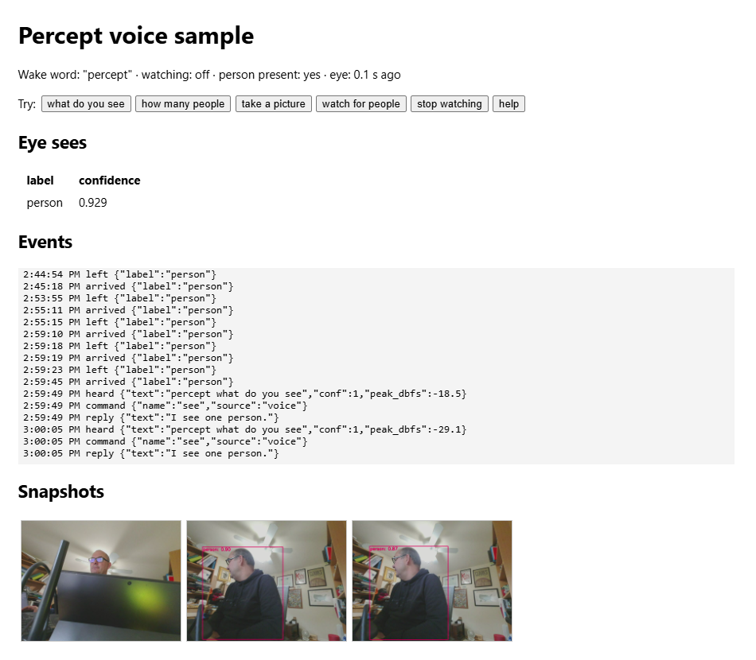

# Sample: voice — ask the Percept what it sees

A sample that uses both SoMs together, fully on the device (no Azure, no PC at runtime):
- Speak a command to the **Ear**'s microphones.
- The sample answers from what the **Eye** sees, using its inferences over MQTT.
- The **mouth** module speaks the reply on a Bluetooth speaker, or on the Ear's line-out.
- Snapshots are grabbed from the Eye's video.

| Say | The device |
|---|---|
| "percept, what do you see" | Says what's detected, e.g. "I see two people and a cup." |
| "percept, how many people" | Says the person count |
| "percept, take a picture" | Chimes, saves an annotated frame to `snapshots/`, says "Picture saved." |
| "percept, watch for people" | When someone arrives: alert tone, snapshot, "Someone is here." |
| "percept, stop watching" | Stops that |
| "percept, help" | Lists the commands |

Say the wake word and command in one breath. Or say "percept", wait for the beep, and give
the command within 5 s. If you say the wake word followed by something that isn't a command, it
answers "Sorry, I didn't understand". Speech without the wake word is ignored. Variants such as
"what can you see", "what are you seeing", "how many people are there", "take a photo" and
"start watching" also work. The full list is `COMMANDS` in `voice.py`.

The Ear's buttons:

| Button | The device |
|---|---|
| **PTT/PTS** | Beeps, then takes a command without the wake word for 5 s ("what do you see") |
| **Mute** | The Ear silences its mics itself; the sample says "Microphones off." / "Microphones on." PTT while muted says so |

The Ear's lights can't be controlled from Ubuntu, so they don't change; spoken feedback
replaces them (see [ear.md](../../ear.md#whats-on-the-board-and-what-linux-can-use)).

## The page

`install` builds and starts the sample with everything else. For replies you can hear, pair a
Bluetooth speaker ([setup.md](../../setup.md#3-pair-a-bluetooth-speaker)) or plug something into
the Ear's line-out.

`http://<ip>:8080/` shows:
- what the Eye sees right now;
- a live event log (heard phrases, commands, replies, alerts);
- the snapshots;
- a button per command, to try one without speaking.



`./percept-kit.sh logs voice` shows the same events as JSON lines.

## How it works

```
 Ear SoM --USB-- [ear :8000] --/stream.wav?ch=mix--> [voice :8080] --> dashboard (HTTP + SSE)
                                                      |   ^
                                    POST /say, /tone  |   | MQTT percept/eye/inferences
                                                      v   |
 speaker <--A2DP / line-out-- [mouth :8001]           [mosquitto] <--MQTT-- [eye] --USB-- Eye SoM
                                                      |                         |
                       MQTT percept/voice/* <---------+   rtsp://eye:8554/result --ffmpeg--> snapshots/*.jpg
```

All containers are on the Docker network `percept` and reach each other by name.

- **Listening**:
  - `voice` reads the average of the Ear's four mics (`/stream.wav?ch=mix`, 16 kHz). It shares
    the Ear's single capture, so the Ear page keeps working.
  - It applies 12 dB of gain and runs [Vosk](https://alphacephei.com/vosk/) offline speech
    recognition with a **fixed grammar**: only the command phrases (with and without the wake
    word) plus `[unk]`.
  - A fixed grammar is fast and accurate on the Cortex-A53, and it rejects ordinary
    conversation. Anything that isn't a command phrase comes out as `[unk]`. After the wake word
    that gets the "didn't understand" reply; without it, it's ignored.
  - At startup every phrase is checked against the model's vocabulary; unknown words are
    reported and the phrase skipped.
- **Buttons**: `voice` polls the Ear's `/levels` 4 times a second. A rise in `ptt_presses`
  plays a beep and opens the same 5 s window as a bare wake word. A change of `mute` is
  announced and published as a `mute` event.
- **Replies**: mouth speaks them with its default voice, the Piper neural voice `en_US-kristin-medium`.
  Piper needs a few seconds per sentence on this CPU, so at start-up `voice` asks mouth to
  render its fixed replies ("Picture saved.", the help text, "I see one person.", …) once. Mouth
  caches them, and they then play immediately. Replies that depend on what the Eye sees
  ("I see two people and a cup.") are synthesised when asked, unless they were said before.
- **Echo guard**: while mouth plays a reply, and for a short tail afterwards (0.4 s on the
  line-out, 1.2 s on Bluetooth, which buffers), the microphone input is discarded and the
  recogniser reset. That way the device doesn't hear itself. Mouth's `/say` returns only when
  playback ends, which is what makes this work.
- **Seeing**:
  - The Eye publishes ~12 messages a second to `percept/eye/inferences`. The format is in
    [eye.md](../../eye.md#inference-results-http-mqtt-stdout).
  - `voice` keeps the latest message's detections at confidence ≥ 0.5, and treats data older
    than 2 s as "can't see".
  - "Watch for people" uses hysteresis: someone *arrives* after 3 consecutive frames with a
    person and has *left* after 3 s without one. Alerts are at least 30 s apart.
- **Snapshots**: `ffmpeg` reads one frame of the Eye's annotated RTSP stream. The Eye's RTSP
  server only offers UDP transport. Snapshots are saved as `snapshots/snap-<date>-<time>.jpg` in
  the `voice-data` volume, keeping the newest 50.
- **Broker**: the device's own, the `mosquitto` service with `services/mqtt/mosquitto.conf`. It
  publishes no port, so only containers on the `percept` network can reach it, and anonymous
  access is acceptable there. `MQTT_URL` moves the Eye and the sample to your broker instead
  ([customize.md](../../customize.md#use-your-own-mqtt-broker)); the sample supports the same
  `mqtt://`, `mqtts://`, `ws://` and `wss://` URLs, credentials and certificates as the Eye.

### MQTT topics published

Every event is also a JSON line in `docker logs voice` and on the dashboard.

| Topic | Payload examples |
|---|---|
| `percept/voice/commands` | `{"ts": 1793975943.095, "type": "command", "name": "see", "source": "voice"}` (`source` is `voice` or `web`) |
| `percept/voice/events` | `{"type": "heard", "text": "percept what do you see", "conf": 1.0, "peak_dbfs": -26.8}` |
| | `{"type": "reply", "text": "I see one person."}` |
| | `{"type": "not_understood", "text": "percept [unk]"}` |
| | `{"type": "snapshot", "file": "snap-20261106-140458.jpg"}` |
| | `{"type": "arrived", "label": "person"}`, `{"type": "left", …}`, `{"type": "alert", "label": "person", "snapshot": "…"}` |
| | `{"type": "watching", "on": true}`, `{"type": "error", "what": "snapshot", "detail": "…"}` |
| | `{"type": "ptt"}`, `{"type": "mute", "on": true}` (Ear buttons) |

Watch them from the device:

```bash
docker exec mosquitto mosquitto_sub -t 'percept/voice/#' -v
```

### HTTP API (port 8080)

| Request | Returns |
|---|---|
| `GET /` | Dashboard |
| `GET /state` | `{"wake_word", "watching", "present", "eye_age", "detections": [...], "commands": {...}}` |
| `GET /events` | Server-sent events, one JSON event per message (last 20 first) |
| `GET /history` | The last 200 events |
| `GET /snapshots`, `GET /snapshots/<file>` | Snapshot names, and the JPEGs |
| `POST /command?name=see` | Runs a command as if it were spoken: `see`, `count`, `picture`, `watch`, `unwatch`, `help` |

## Configure

The sample's settings are the `VOICE_*` lines in `config/percept.env`, each documented there: the
wake word, the microphone and its gain, the reply voice, the confidence and timing of "watch for
people", and the number of snapshots kept. The common changes are recipes in
[customize.md](../../customize.md#change-the-voice-sample). The broker and topics are the shared
`MQTT_*` settings.

To add a command:
1. Add its phrases to `COMMANDS` and a handler to `HANDLERS` in `voice.py`.
2. `./percept-kit.sh deploy`: the voice image is rebuilt and restarted.

## Test without speaking

The image can recognise WAV files instead of the microphone. Mouth can render test phrases:

```bash
# on the device
mkdir -p /tmp/t && cd /tmp/t
curl -s -X POST --data "percept, take a picture" "http://localhost:8001/say?render=1" -o 1.wav
curl -s -X POST --data "the weather is nice today" "http://localhost:8001/say?render=1" -o 2.wav
docker run --rm -v /tmp/t:/t:ro percept/sample-voice --test /t/1.wav /t/2.wav
# /t/1.wav: picture ('percept take a picture', conf 1.0, peak -4.5 dBFS)
# /t/2.wav: no command
```

## What it downloads (at build time, pinned)

| What | Licence | Pin |
|---|---|---|
| [vosk](https://github.com/alphacep/vosk-api) 0.3.45 (aarch64 wheel) | Apache-2.0 | SHA-256 in `requirements.txt` |
| [srt](https://github.com/cdown/srt) 3.5.3 (vosk imports it) | MIT | SHA-256 in `requirements.txt` |
| [vosk-model-small-en-us-0.15](https://alphacephei.com/vosk/models) (40 MB) | Apache-2.0 | SHA-256 in `Dockerfile` |
| Ubuntu 22.04 packages: python3, paho-mqtt 1.5, requests, tqdm, cffi, libatomic1, ffmpeg | Ubuntu archive licences (ffmpeg LGPL/GPL) | Ubuntu archive |

The broker, `eclipse-mosquitto` (EPL-2.0 / EDL-1.0), is a service of the stack, pinned in
[compose.yaml](../../compose.yaml). Nothing third party is committed to this repository. The pip
index can be changed with `PIP_INDEX_URL` in `config/percept.env`; the kit passes it as a build
argument.

## Measured on the device

| | |
|---|---|
| Image | `percept/sample-voice` 513 MB (ffmpeg and its libraries are most of it); mosquitto ~12 MB |
| RAM | voice ~160 MB, mosquitto ~3 MB, mouth ~290 MB with the Piper voice; ~1.5 GB still available with every module running |
| CPU | voice ~30% of one core while listening, eye ~115% |
| Speech model load | ~3 s |
| Reply time | Pre-rendered or repeated replies start at once; a new sentence such as "I see two people and a cup." takes ~2–5 s to synthesise, then plays |
| Recognition | 11/11 synthetic test phrases correct (6 commands, wake word alone, 4 rejections); with the `percept` wake word, phrases in both the Piper and espeak-ng voices recognised, "percept, what time is it" flagged as not understood, "computer, …" and chatter ignored; the added variants ("what you see", "what are you seeing", "how many people are there", "how many people you see") recognised with confidence 1.0; live commands from ~1 m recognised with confidence 0.7–1.0, including "what do you see" after PTT |

## Limits

- English only. Other Vosk small models exist; change `MODEL`/`MODEL_SHA256` in the
  `Dockerfile`, and the phrases.
- Four raw microphones averaged, with no beamforming or echo cancellation (the Ear firmware
  doesn't provide them on its USB stream): expect it to work at about 1–3 m in a quiet room.
  Loud music or TV near the device causes misses, not false commands. Pauses split a phrase:
  "percept … what do you see" with a pause in between becomes "percept" (which opens the 5 s
  window) and then the command.
- If nothing is recognised and the Ear page shows −120 dBFS on every mic, the Ear's Mute is on.
- The commands are a fixed list. This is a command recogniser, not dictation or a chatbot.
- Like the other modules' pages, the dashboard has no authentication.
