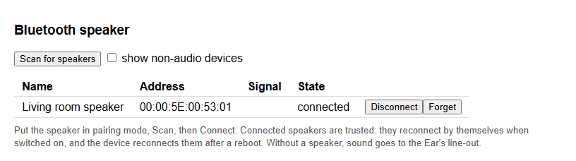
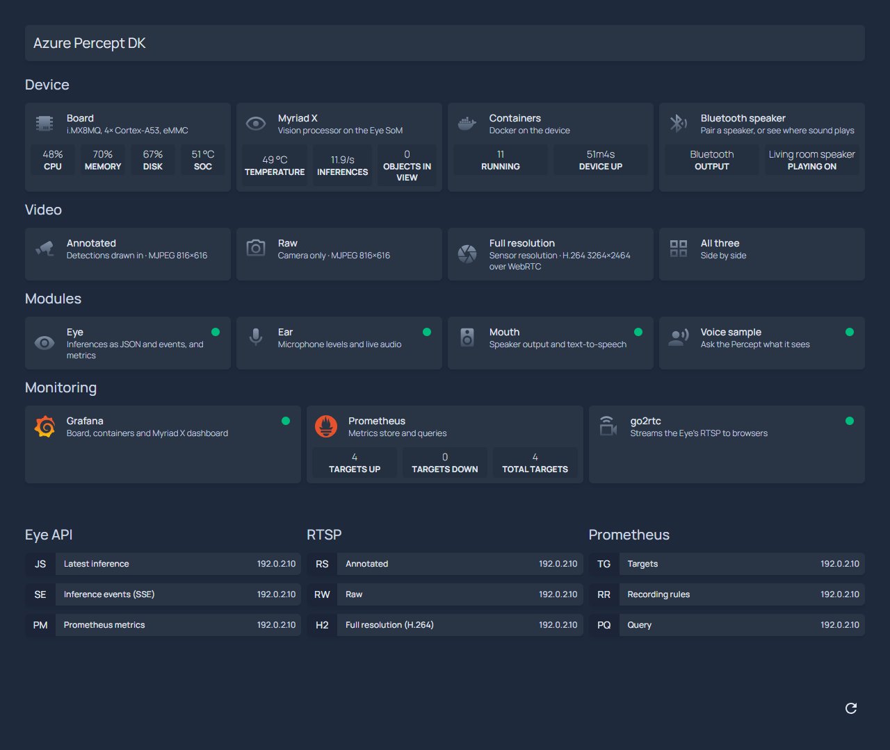

# Setup: Azure Percept DK to standalone Ubuntu

One command takes an Azure Percept DK that runs its stock software to Ubuntu 22.04 with everything
running: the Eye, Ear and mouth modules, the MQTT broker, the voice sample, and the home page with
the dashboards and video. You can go back to the stock software at any time.

- [README.md](README.md) explains what each step does under the hood.
- [customize.md](customize.md) covers changing things afterwards: a new model, your own MQTT
  broker, your own containers.

## Before you start

**The Percept DK**
- Running the stock Azure Percept OS (CBL-Mariner, `apd-xxxx` hostname), not modified by hand.
- The Azure Percept setup experience has been completed:
  - a user name and password were created;
  - SSH is enabled;
  - it joined your Wi-Fi network.

  You don't need an Azure IoT Hub connection.
- You know its IP address (from your router, or the setup experience's last page) and can
  `ssh <user>@<ip>` from your PC.
- The Eye and Ear SoMs connected with their USB-C cables.
- Mains power. Keep it powered during `install` and `restore`.
- Internet access. The device downloads about 1.5 GB: Ubuntu, container images and speech models.

**Your PC**
- Windows with [Git for Windows](https://git-scm.com/download/win) (provides Git Bash, `ssh` and
  `sha256sum`), or any Linux/macOS machine with bash 4 and OpenSSH.
- About 7 GB of free disk space for the backup, and a copy of this repository.
- On the same network as the device.

Run every command from the repository folder in Git Bash:

```bash
git clone https://github.com/howardginsburg/AzurePerceptDKUbuntu.git && cd AzurePerceptDKUbuntu
```

Commands print what they're about to do and ask before anything destructive. Add `-y` to skip the
questions (`./percept-kit.sh -y install`).

## 1. Connect

```bash
./percept-kit.sh connect <device-ip> <user>
```

- Creates the SSH key `~/.ssh/id_ed25519_percept`, if you don't have it.
- Asks for the device password **once** to install the key.
- Asks for it once more, for `sudo`, to add the kit's passwordless-sudo rule.
- Saves the address and user in `.percept-kit.conf`, so later commands need no arguments.
- Ends with the device state:

```
State:   stock Azure Percept OS. Next: './percept-kit.sh install' (it takes a backup first).
```

`./percept-kit.sh status` shows the state at any time.

## 2. Install

```bash
./percept-kit.sh install                      # host name percept-ubuntu
./percept-kit.sh install --hostname my-percept
```

It asks once, then runs by itself for 1–2.5 hours. The device reboots several times.

| Phase | Time | What happens |
|---|---|---|
| Backup | 20 min | The whole eMMC is imaged to `backups/<date>-<id>/` on your PC, with the device's copy of the Eye's build base. Skipped when this device already has a backup |
| Rescue Mariner | 3 min | Mariner's `/var` moves to p4, and IoT Edge, Docker and updates are switched off. Mariner stays on the device as a rescue system |
| Image p5 | 10–15 min | A clean copy of Mariner's old `/var` is added to the backup |
| Ubuntu | 20–40 min | Ubuntu 22.04 is built on p5, then booted **once** as a trial |
| Commit | seconds | Ubuntu has booted, so it becomes the default |
| Deploy | 30–55 min | The Eye's build base is loaded from the backup; the Eye (15–30 min), Ear, mouth and voice sample images are built on the device; the other images are downloaded; and everything starts |
| Check | 5 min | A reboot, then every component is checked |

It ends with every component's state and address:

```
==> Checking every component
Component           State   Address
Home page           ok      http://<ip>/
Grafana             ok      http://<ip>:3000/
Video               ok      http://<ip>:1984/
Eye                 ok      http://<ip>:8555/  rtsp://<ip>:8554/result
Ear                 ok      http://<ip>:8000/
Mouth               ok      http://<ip>:8001/
Bluetooth speaker   ok      http://<ip>:8001/#bt
Voice sample        ok      http://<ip>:8080/
MQTT broker         ok      mqtt://mosquitto:1883 (containers only)
Prometheus          ok      http://<ip>:9090/
Board metrics       ok      http://<ip>:9100/metrics
Container metrics   ok      (Prometheus target)
==> Done. Everything is linked from http://<ip>/
==> Next: pair a Bluetooth speaker at http://<ip>:8001/#bt (or './percept-kit.sh bt scan', then './percept-kit.sh bt pair <MAC>')
```

If a phase fails, fix the cause (usually the network) and run `./percept-kit.sh install` again: it
carries on from where it stopped. A trial boot that hangs ends with the watchdog or a power cycle
back in rescue Mariner, and `install` carries on from there too.

**Keep the backup folder, and keep it private.** It's the only way back to the stock OS (Microsoft
no longer offers a download of the Percept image), and it holds your Wi-Fi password, SSH host keys
and password hash. Never commit or share it.

## 3. Pair a Bluetooth speaker

The device speaks its replies on a Bluetooth speaker, or on the Ear's 3.5 mm line-out when no
speaker is connected.

1. Put the speaker in pairing mode.
2. On the home page, `http://<ip>/`, open the **Bluetooth speaker** card. It shows where sound
   plays now, and opens the mouth page's Bluetooth section (`http://<ip>:8001/#bt`).
3. Select **Scan for speakers**. After 12 s the speakers nearby are listed; other kinds of device
   are hidden unless you tick *show non-audio devices*.
4. Select **Connect** on your speaker's row. Pairing takes up to a minute, then the row says
   *connected*.
5. Select **Say** at the top of the page to hear it.



Once paired:
- the speaker is used whenever it's connected; turn it off and sound goes to the line-out;
- most speakers reconnect by themselves when turned back on, and the device reconnects trusted
  speakers at boot;
- **Forget** removes the pairing.

From your PC instead:

```bash
./percept-kit.sh bt scan              # 15 s; lists name, MAC, signal and "audio: yes" for speakers
./percept-kit.sh bt pair <MAC>        # pair, trust and connect
./percept-kit.sh bt status            # paired devices, and the speakers sound can play on
```

Speakers that need a PIN, and Bluetooth LE Audio devices, aren't supported
([mouth.md](mouth.md#limits)).

## 4. What you have

Open `http://<ip>/`. Every page on the device is linked from there, with live numbers.



- Each component and its address is listed in [README.md](README.md#what-you-get).
- Say "percept, what do you see" near the device, or try the voice sample's buttons at
  `http://<ip>:8080/` ([samples/voice/README.md](samples/voice/README.md)).
- Log in as before: `ssh <user>@<ip>`, with the same user, password, SSH key and host key as on
  Mariner. The HDMI port shows a Linux console, and a USB keyboard works for local login.

## Day to day

| Task | Command |
|---|---|
| Every component's state and address | `./percept-kit.sh status` |
| Apply changes from your PC | `./percept-kit.sh deploy`; see [customize.md](customize.md) |
| Recent log lines | `./percept-kit.sh logs [service] [lines]` |
| Restart, stop or start a component | `./percept-kit.sh restart|stop|start <service>` |
| Rebuild an image from scratch | `./percept-kit.sh rebuild eye|ear|mouth|voice` |
| Any `docker compose` command | `./percept-kit.sh compose <args>`, or `docker compose` in `~/percept-kit` on the device |
| Bluetooth from the command line | `./percept-kit.sh bt scan|pair|connect|disconnect|forget|status` |
| The Eye's build base | `./percept-kit.sh eye-base status|save|remove|restore`; see [customize.md](customize.md#free-up-disk-space) |
| Update Ubuntu | `ssh <user>@<ip> 'sudo apt update && sudo apt full-upgrade'` (the kernel isn't affected) |
| Boot rescue Mariner once | `./percept-kit.sh boot mariner` (the next reboot returns to Ubuntu) |
| Boot Ubuntu once without HDMI | `./percept-kit.sh boot ubuntu-nohdmi` |
| Make Mariner the default again | `./percept-kit.sh commit mariner` |

The services are `eye`, `ear`, `mouth`, `voice`, `mosquitto`, `homepage`, `grafana`,
`prometheus`, `node-exporter`, `cadvisor` and `go2rtc`.

## Restore the stock Azure Percept OS

```bash
./percept-kit.sh restore                         # newest backup of this device
./percept-kit.sh restore backups/<date>-<id>     # a specific one
```

- Works from Ubuntu or rescue Mariner, with one or two reboots, taking about 20 minutes.
- Every partition it writes is read back and checked against the backup's hashes.
- The result is the device exactly as it was at backup time: OS, IoT Edge configuration,
  containers, Wi-Fi and user.

## Disconnect

```bash
./percept-kit.sh disconnect               # remove the kit's scripts and passwordless sudo rule
./percept-kit.sh disconnect --remove-key  # ... and the kit's SSH key
```

The containers keep running.

## Troubleshooting

### A component shows `failed`

`./percept-kit.sh logs <service>` shows why, and `./percept-kit.sh restart <service>` restarts it.
The check also prints warnings that need you, not the software:
- *no Eye SoM on USB*: plug it in; the Eye waits for it.
- *the Eye isn't running a model yet*: it takes up to a minute after a start.
- *no Ear SoM sound card* or *no Bluetooth adapter*: see below.

### The Ear or Bluetooth is missing after a reboot

Now and then, the i.MX8MQ's second USB controller doesn't come up at boot. Neither the Ear SoM nor
the Bluetooth adapter appears. Check:

```bash
sudo dmesg | grep -i 'failed to command PGC'      # present when it happened
ls /sys/class/bluetooth                           # empty
cat /proc/asound/cards                            # no "USB" card
```

Only a reboot fixes it (`./percept-kit.sh boot ubuntu`, or `sudo reboot`). Everything returns by
itself afterwards; a paired speaker reconnects.

### The voice sample doesn't respond

- **Mics muted**: the Ear's lights don't show it under Ubuntu. Open `http://<ip>:8000/`: the
  levels sit at −120 dBFS and the page says *Mute: ON*. Press the Mute button (the sample
  says "Microphones on.").
- **Too quiet to hear**: check the speaker's own volume. The mouth sets the Bluetooth volume to
  100% each time the speaker connects.
- **Is it hearing you?** `./percept-kit.sh logs voice` shows every recognised phrase. Say the
  whole command without a pause, or press PTT/PTS and skip the wake word.

### `deploy` says there isn't enough space

See [customize.md](customize.md#free-up-disk-space). `deploy` checks before building or downloading,
and leaves the running stack as it was.

### If the IP address changes

Ubuntu's DHCP client may identify itself differently from Mariner's, so your router may give it a
new address after the trial boot. Find it in the router's client list (host name
`percept-ubuntu`, or the one you chose), then:

```bash
./percept-kit.sh connect <new-ip>
./percept-kit.sh install           # during install: it carries on
./percept-kit.sh deploy            # afterwards: the home page's links use the address
```

A DHCP reservation for the Wi-Fi MAC address avoids this. `./percept-kit.sh assess` prints the MAC
address.

### SSH times out on Mariner, but the device is on the network

Stock and rescue Mariner drop SSH from any address that opens more than 5 new connections in 60
seconds, and every retry restarts the 60 seconds. Ping never works on Mariner (ICMP is blocked), so
it can't tell you whether the device is up.

**Fix:** stop all connection attempts for 2 minutes and try again. If you're still logged in
somewhere, you can clear the block immediately:

```bash
echo / | sudo tee /proc/net/xt_recent/DEFAULT
```

While a kit command runs, it exempts your PC from this rule until the next reboot. Ubuntu doesn't
have the rule.

### `install` stopped with "Ubuntu did not come up"

The device is back in rescue Mariner. Read the build log:

```bash
ssh <user>@<ip> 'tail -n 50 /var/tmp/pk-build.log'
```

Then run `./percept-kit.sh install` again. The HDMI console helps if the kernel starts but userland
doesn't.

### Nothing answers at all

Power-cycle the device. A trial boot falls back to the default entry: rescue Mariner until
`install` makes Ubuntu the default, Ubuntu after that.

### The `apd-xxxx` Wi-Fi hotspot is visible

That's the stock OS's setup hotspot, normal on Mariner. Ubuntu doesn't run it.
